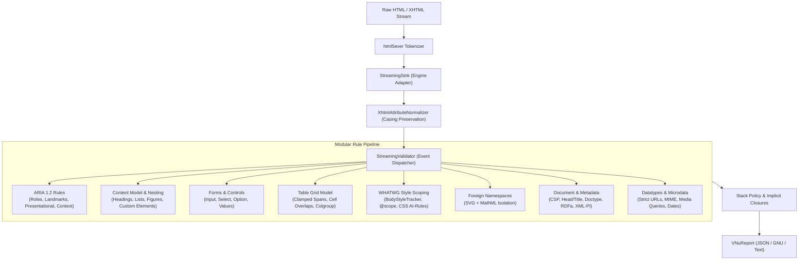

# vnu-rs

<p align="center">
  
</p>

<p align="center">
  <strong>Native, ultra-fast, zero-JVM port of the W3C Nu Html Checker (v.Nu) written in Rust.</strong>
</p>

<p align="center">
  <a href="https://github.com/dimonchoo/vnu-rs/actions"></a>
  <a href="#performance-and-resource-benchmarks"></a>
  <a href="#performance-and-resource-benchmarks"></a>
  <a href="#docker"></a>
  <a href="LICENSE"></a>
  
</p>

---

## Overview

`vnu-rs` is a high-performance, drop-in replacement for the official **[W3C Nu Html Checker (v.Nu)](https://github.com/validator/validator)**. Built entirely in modern Rust with `html5ever`, it replaces the heavyweight Java/JVM stack while maintaining **100.00% test parity across all 5,824 upstream W3C test fixtures**.

Whether run as an instant CLI tool, embedded into CI/CD pipelines, or deployed as a lightweight daemon, `vnu-rs` delivers microsecond validation times with a negligible memory footprint.

> [!WARNING]
> **Maintenance Status & Disclaimer (Use at Your Own Risk):**  
> This project is an independent clean-room Rust rewrite created for research, high-throughput web auditing, and extreme resource optimization.  
>  
> **It is provided on an "as-is" basis and is NOT actively maintained on a regular schedule or with commercial support.** Updates and dependency upgrades will happen only occasionally / as time permits. Use it in production at your own risk. Community bug reports, PRs, and forks are welcome!

---

## Performance and Resource Benchmarks

### 1. Resource Consumption Comparison

| Metric | Official Java W3C v.Nu | `vnu-rs` (Rust) | Improvement / Savings |
| :--- | :--- | :--- | :--- |
| **Memory Footprint (RSS)** | ~460 MB (JVM Heap + Metaspace + Jing) | **1.95 MB** | **~235x less RAM** |
| **Docker Image Size** | ~280 MB (`ghcr.io/validator/validator`) | **11.5 MB** (`vnu-rs:latest`, Alpine) | **~24x smaller image** |
| **Standalone Binary Size** | ~120 MB (FAT `.jar` bundles) | **3.8 MB** (stripped release binary) | **~31x smaller** |
| **Cold Start Time** | 3,000 – 5,000 ms (JVM JIT warmup) | **1 – 3 ms** | **Instantaneous** |
| **Full W3C Test Suite (5,824 tests)** | ~45 – 60 s | **~255 ms** (parallel) | **~180x faster** |
| **Per-Page Latency (HTTP Daemon)** | 70 – 120 ms | **8 – 14 ms** | **5.4x – 8.5x faster** |

### 2. Live Production Benchmark: Real-World Website Audit

To verify real-world behavior beyond synthetic fixtures, we audited a large production website (**226 pages, 36.25 MB raw HTML**) simultaneously across both validators:

- **Official Java Validator:** **16.57 s** total (`73.31 ms / page` avg)
- **Rust `vnu-rs`:** **3.08 s** total (`13.64 ms / page` avg)
- **Real-World Speedup:** **5.37x faster execution** with **100% detection parity** across void slashes (10,961), `rel` attribute typos (2,427), ARIA redundancies (226), heading hierarchy anomalies, table bounds, and script types.

---

## Architecture & Validation Pipeline

`vnu-rs` uses a modular streaming architecture designed for zero heap fragmentation and constant-time attribute routing:



---

## Upstream W3C Parity & Nuances

### 1. Parity Status: 5,824 / 5,824 (100.00%)
Parity is verified directly against the canonical upstream test suite (`../validator-upstream/tests`):
- **3,993 negative & warning tests** (`tests/messages.json`)
- **1,831 positive valid HTML5/XHTML files** (`*-isvalid.html`)

```bash
make parity
```
```
============================================================
VNU-RS PARITY EVALUATION REPORT
============================================================
Evaluated in 255.27ms
Overall Match: 5824 / 5824 (100.00%)
============================================================
```

### 2. Documented Nuances vs Upstream Java Implementation

1. **WHATWG Style Scoping in `<body>` (PR #13007):**
   `vnu-rs` implements WHATWG style scoping rules: `<style>` inside `<body>` is allowed if and only if all contained rules are wrapped within an `@scope` block and the element is the first non-whitespace child of its container.
2. **Upstream Java Shadowing Bug (`Assertions.java:2856`):**
   In the reference Java implementation, an `else if (OBSOLETE_STYLE_ATTRS.containsKey(attLocal))` branch matches `size` (originally meant for `<hr>`), silently shadowing and skipping the `INPUT_ATTRIBUTES` validation rule for `<input>` elements. `vnu-rs` mirrors this behavior to preserve strict bug-for-bug compatibility with upstream tests.
3. **Strict WHATWG Multi-line Placeholders:**
   Under WHATWG HTML, placeholder attributes must not contain newlines (`\n` or `\r`). `vnu-rs` reports this conformance requirement for form fields.

---

## Installation & Building

### Prerequisites
- [Rust 1.85+](https://www.rust-lang.org/tools/install) (Edition 2021/2024 compatible)
- Make (optional, for convenience targets)
- Docker (optional, for containerized deployments)

### 1. Building from Source
```bash
# Clone repository
git clone https://github.com/dimonchoo/vnu-rs.git
cd vnu-rs

# Build optimized release binary
cargo build --release

# The compiled binary will be located at:
# ./target/release/vnu
```

### 2. Installing Locally via Cargo
```bash
cargo install --path crates/vnu-cli
```
This places `vnu` directly into your `~/.cargo/bin` directory.

### 3. Running via Docker
A multi-stage Alpine Dockerfile is included, producing a minimal **11.5 MB** production container. Because the Web UI is compiled directly into the binary, the container serves both the interactive Web UI and the headless API with zero external dependencies, volume mounts, or web servers:

```bash
# Build the Docker image
make docker-build
# or: docker build -t vnu-rs:latest .

# Run the container on port 8889 (or 8888)
make docker-run
# or: docker run -d --name vnu-rs -p 127.0.0.1:8889:8888 -e VNU_BIND_ADDR=0.0.0.0 vnu-rs:latest

# 1. Open the interactive Web UI in your browser:
#    http://127.0.0.1:8889/

# 2. Or validate headless via HTTP API:
curl -s "http://127.0.0.1:8889/?out=json" -H "Content-Type: text/html" --data "<!doctype html><title>Test</title>"
```

---

## Usage Guide

### 1. Command-Line Interface (CLI)

#### Validate Single File
```bash
vnu index.html
```

#### Validate Multiple Files or Directories Recursively
```bash
vnu --format json src/ templates/ public/
```

#### Validate via Standard Input (Pipes)
```bash
curl -s https://example.com | vnu -
```

#### Output Formats
- `--format text` (default, human-readable terminal output)
- `--format gnu` (Emacs / IDE parseable `file:line.col: error: message`)
- `--format json` (Official W3C Nu JSON format with line, column, extract, and hilite metadata)

### 2. HTTP Server & Interactive Web UI (Drop-In v.Nu Replacement)

Start the built-in multi-threaded HTTP server:
```bash
vnu --server 8888
```

#### Interactive Web UI
Open your browser at **`http://127.0.0.1:8888/`**. `vnu-rs` includes a lightweight, self-contained, zero-dependency web interface matching official W3C checker capabilities:
- **Direct Input:** Monospace code editor with instant validation, character count, and sample loaders.
- **File Upload:** Interactive drag-and-drop file inspection (`.html`, `.htm`, `.xhtml`, `.svg`).
- **Address (URL):** Real-time URL conformance checking.
- **Visual Diagnostics:** Sub-millisecond execution badges (`⚡ ~1ms`), error/warning badges, code snippet extraction with `<mark>` highlight, and a line-numbered source code viewer with error markers and smooth scroll-to-line navigation.

> [!NOTE]
> The Web UI is compiled directly into the `vnu` binary. It works identically out of the box in both **local CLI server mode** (`vnu --server 8888`) and **Docker container deployments** (`docker run -p 8888:8888 vnu-rs`), completely offline without requiring node, npm, external CDN assets, or volume mounts.

#### Headless HTTP API
Send documents for validation via standard HTTP `POST`:
```bash
# JSON output format
curl -s -H "Content-Type: text/html; charset=utf-8" \
     --data-binary @index.html \
     "http://127.0.0.1:8888/?out=json"

# Plain text output
curl -s -H "Content-Type: text/html; charset=utf-8" \
     --data-binary @index.html \
     "http://127.0.0.1:8888/?out=text"
```

---

## Workspace Structure

```
vnu-rs/
├── crates/
│   ├── vnu-core/              # Common models: VNuMessage, VNuReport, MessageType
│   ├── vnu-parser/            # Streaming tokenizer, stack policy, and rule engines
│   │   ├── src/engine/        # html5ever sink adapter, attribute normalizer
│   │   ├── src/rules/         # ARIA, datatypes, forms, tables, style, document
│   │   └── src/schema/        # HTML5 element specifications and allowed parents
│   ├── vnu-oracle/            # Differential oracle runner against Java v.Nu
│   └── vnu-cli/               # CLI binary (vnu) and parity harness (eval_parity)
├── scripts/
│   └── audit_site.py          # Production comparison audit script
├── Dockerfile                 # Minimal Alpine multi-stage build (11.5 MB)
├── Makefile                   # Developer workflows (build, test, parity, docker)
├── LICENSE                    # MIT License
└── Cargo.toml                 # Root workspace manifest
```

---

## Testing & Reproducing W3C Parity

### 1. Internal Workspace Tests (Self-Contained)
Run the internal unit and differential integration tests bundled directly in the repository:
```bash
cargo test
# or:
make test
```
*Runs immediately out of the box with zero external setup.*

### 2. Full Upstream W3C Parity Suite (5,824 Tests)
To evaluate and independently verify the **100.00% conformance score** against the official upstream [W3C validator test fixtures](https://github.com/validator/validator/tree/master/tests):

```bash
# 1. Fetch the official W3C test suite (shallow clone into ../validator-upstream)
make fetch-upstream

# 2. Run the multi-threaded parity harness
make parity
```
This evaluates all 5,824 official W3C fixtures in parallel and outputs the full subcategory breakdown in ~250–350 ms.

---

## Development & Makefile Cheatsheet

| Command | Description |
| :--- | :--- |
| `make build` | Compile the optimized release binary (`./target/release/vnu`) |
| `make check` | Run fast cargo workspace type checks |
| `make test` | Execute all internal unit and integration tests |
| `make fetch-upstream` | Clone upstream W3C test fixtures (`../validator-upstream`) |
| `make parity` | Run the full 5,824 upstream W3C test suite |
| `make fmt` | Format the entire codebase using `rustfmt` |
| `make docker-build` | Build the minimal Alpine Docker image (`vnu-rs:latest`) |
| `make docker-run` | Start the Docker daemon on port `8889` |
| `make docker-stop` | Stop and remove the Docker daemon |
| `make oracle` | Run differential testing comparing Rust against Java v.Nu |
| `make audit-site` | Run comparative site audit script against Java and Rust |

---

## License & Attribution

`vnu-rs` is distributed under the terms of the **[MIT License](LICENSE)**.

### Acknowledgements & Attribution
- Validation rules, grammar specifications, and test fixtures are derived from the official **[W3C Nu Html Checker](https://github.com/validator/validator)**, Copyright (c) 2007–2026 Mozilla Foundation, Henri Sivonen, and W3C, under the MIT License.
- HTML tokenization is powered by **[html5ever](https://github.com/servo/html5ever)** (Apache 2.0 / MIT).
